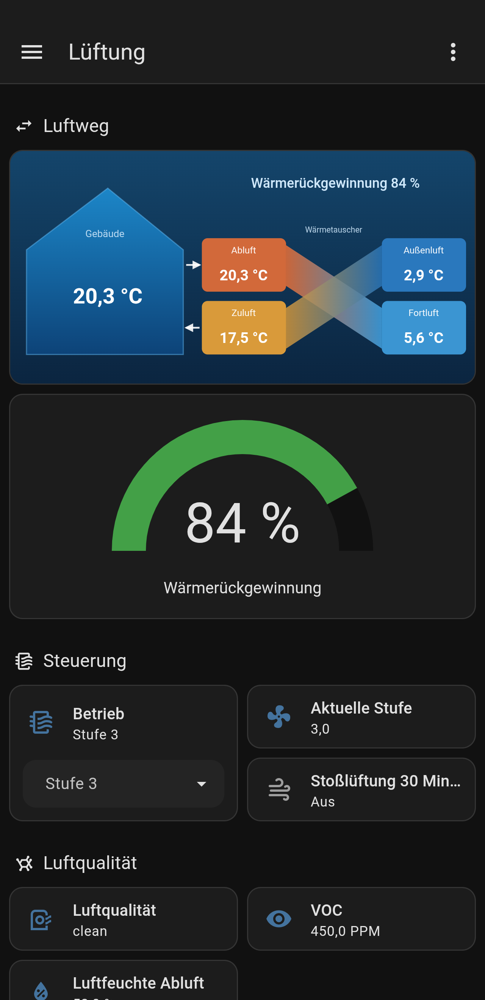
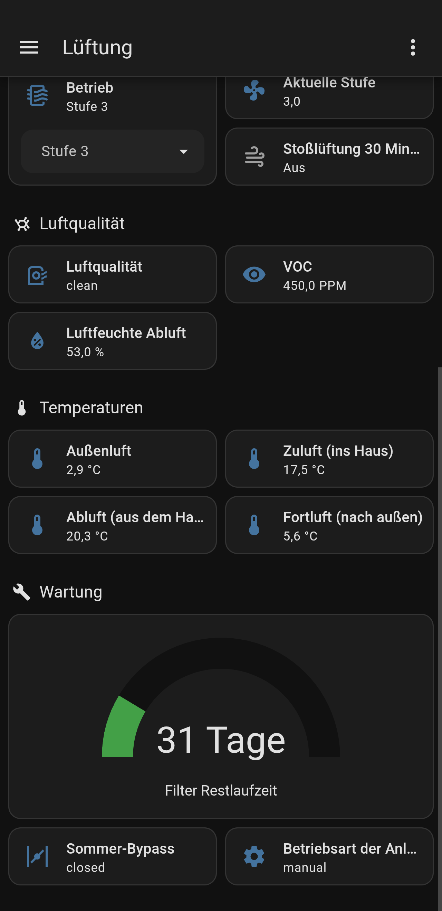

# KM200 HRV → Home Assistant

Home Assistant add-on that connects a **Buderus Logavent HRV2** ventilation unit (with heat recovery) to Home Assistant via MQTT, using the **Logamatic web KM200 HRV** internet module – local only, no cloud. Includes example automation, dashboard and helpers.

> 🇩🇪 Deutsche Version: [README.md](README.md)

> ⚠️ **Unofficial community project.** Not affiliated with Buderus, Bosch or Junkers. All trademarks belong to their owners. Use at your own risk: the add-on can **write** values to the unit (e.g. fan level). Tested so far only with a Logavent HRV2-230.

## Background

According to the author, the Logamatic web KM200 HRV internet module is no longer part of the manufacturer's range, but many units are still in use. This add-on accesses the module only locally on your home network and needs no cloud.

**Tip:** Keep a safe note of the gateway password (sticker) and your private password. If the MyVent app or cloud service is ever shut down, you may no longer be able to set a new private password there.

## What you get

- **Add-on "KM200 HRV Bridge"**: reads all data points below `/ventilation` (temperatures, fan level, VOC, humidity, bypass, filter remaining time, operating mode …) and creates entities through MQTT discovery. Writable values become `select`/`number` entities so you can control the unit from HA.
- **Home Assistant examples** (folder `homeassistant/`): automation "fan level by air quality", 30-minute boost script, helpers (mode selector, calculated heat recovery %), and a "Ventilation" dashboard.

## Dashboard preview

  
  

## Requirements

- Home Assistant with **Supervisor** (Home Assistant OS or Supervised)
- An **MQTT broker** (e.g. the "Mosquitto broker" add-on) and the MQTT integration
- A Buderus Logavent HRV2 with the **Logamatic web KM200 HRV** module on the same network
- The **gateway password** (sticker on the KM200) and the **private password** you set in the MyVent app

## Installation

1. *Settings → Add-ons → Add-on Store → ⋮ → Repositories*, add: `https://github.com/BERG90/km200hrv-ha`
2. Install **KM200 HRV Bridge**.
3. Set `host`, `gateway_password`, `private_password` and start the add-on.
4. The log lists the discovered data points; the device **Logavent HRV2** appears under MQTT.

Alternatively copy the `km200hrv/` folder to `/addons/km200hrv/` on your HA system (local add-on).

### Options

| Option | Meaning |
| --- | --- |
| `host` | IP of the KM200 HRV (use a fixed IP/DHCP reservation) |
| `gateway_password` | Gateway password from the sticker (xxxx-xxxx-xxxx-xxxx, dashes optional) |
| `private_password` | Your private password from the MyVent app |
| `aes_key` | Optional: ready-made 64-character hex key (replaces both passwords) |
| `roots` | Areas to read, default `/ventilation` (add `/system` if you like) |
| `scan_interval` | Polling interval in seconds (15–3600) |
| `log_level` | `debug`, `info`, `warning` |

MQTT credentials are obtained from the Supervisor automatically. Topics: state `km200hrv/state/<id>`, write `km200hrv/set/<id>`.

## Notes and limits

- Communication with the KM200 is plain HTTP on your LAN (AES-encrypted payload). Don't poll more often than needed; the default is 60 seconds.
- The gateway expects a specific User-Agent (`TeleHeater/…`), so the add-on sends the well-known identifier. It is only a protocol identifier and does not imply official software.
- Writes act directly on the unit. Test new automations with fixed values first.
- Multiple units or other Buderus devices behind one KM200 are untested.

## Credits

The gateway encryption scheme (well-known salt, AES key derived from gateway and private password) is documented by the community projects FHEM `73_km200` and ioBroker.km200. The code in this repository is an independent implementation.

## About this project

This project was developed by a hobby user with the help of Claude (Anthropic) and runs in production on a Logavent HRV2-230. There is no support, but improvements and bug reports are welcome.

## License

[MIT](LICENSE)
