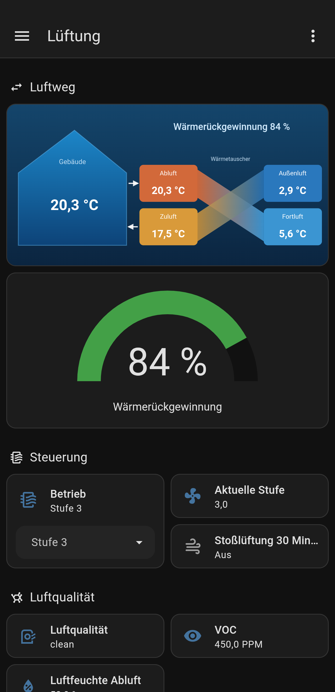
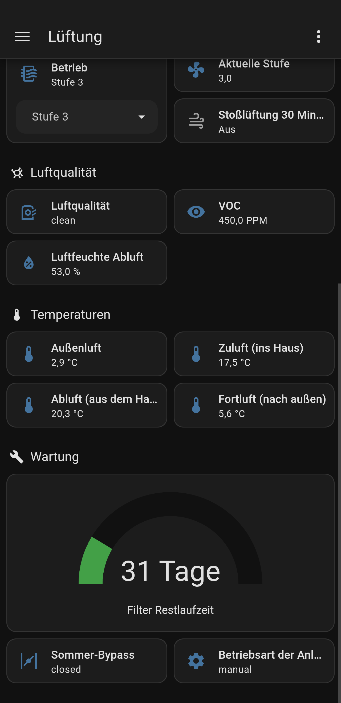

# Buderus KM200 HRV → Home Assistant

Home-Assistant-Add-on, das eine **Buderus Logavent HRV2** (Lüftungsanlage mit Wärmerückgewinnung) über das Internet-Modul **Logamatic web KM200 HRV** per MQTT in Home Assistant einbindet – lokal, ohne Cloud. Dazu gibt es Beispiele für Automation, Dashboard und Helfer.

> 🇬🇧 English version: [README.en.md](README.en.md)

> ⚠️ **Inoffizielles Community-Projekt.** Keine Verbindung zu Buderus, Bosch oder Junkers. Alle Marken gehören ihren Inhabern. Nutzung auf eigene Gefahr: Das Add-on kann Werte in der Anlage **schreiben** (z. B. Lüfterstufe). Getestet wurde es bisher nur mit einer Logavent HRV2-230.

## Hintergrund

Das Internet-Modul Logamatic web KM200 HRV ist nach Angaben des Autors nicht mehr im Programm des Herstellers, viele Anlagen sind aber noch im Einsatz. Dieses Add-on greift ausschließlich lokal im Heimnetz auf das Modul zu und braucht keine Cloud.

**Tipp:** Notiere dir das Gerätepasswort (Aufkleber) und dein privates Passwort an einem sicheren Ort. Sollte die MyVent-App oder der Cloud-Dienst irgendwann abgeschaltet werden, kannst du das private Passwort dort womöglich nicht mehr neu vergeben.

## Was du bekommst

- **Add-on „KM200 HRV Bridge“**: liest alle Datenpunkte unter `/ventilation` (Temperaturen, Lüfterstufe, VOC, Feuchte, Bypass, Filter-Restlaufzeit, Betriebsart …) und legt sie per MQTT-Discovery als Entitäten an. Beschreibbare Werte werden zu `select`/`number`, damit du die Anlage aus HA steuern kannst.
- **Beispiele für Home Assistant** (Ordner `homeassistant/`):
  - Automation „Stufe nach Luftqualität“ (VOC, Feuchte, Anwesenheit, Nacht, Bypass)
  - Script „Stoßlüftung 30 Minuten“
  - Helfer (Betriebswahl, berechnete Wärmerückgewinnung in %)
  - Dashboard „Lüftung“ inkl. Grafik des Luftwegs

## So sieht das Dashboard aus

  
  

## Voraussetzungen

- Home Assistant mit **Supervisor** (Home Assistant OS oder Supervised), da es ein Add-on ist
- **MQTT-Broker** (z. B. das Add-on „Mosquitto broker“) und die MQTT-Integration in HA
- Eine Buderus Logavent HRV2 mit Internet-Modul **Logamatic web KM200 HRV**, im selben Netzwerk erreichbar
- Das **Gerätepasswort** (Aufkleber am KM200) und das **private Passwort**, das du in der MyVent-App vergeben hast

## Installation

1. In Home Assistant: *Einstellungen → Add-ons → Add-on-Store → ⋮ → Repositories* und diese Repository-URL hinzufügen:
   `https://github.com/BERG90/km200hrv-ha`
2. Add-on **KM200 HRV Bridge** installieren.
3. Unter *Konfiguration* eintragen: `host`, `gateway_password`, `private_password` (Details unten) und starten.
4. Im Log siehst du die gefundenen Datenpunkte. In HA erscheint das Gerät **Logavent HRV2** (MQTT).

Alternativ den Ordner `km200hrv/` nach `/addons/km200hrv/` auf dem HA-System kopieren (lokales Add-on, Add-on-Store neu laden).

### Konfiguration

| Option | Bedeutung |
| --- | --- |
| `host` | IP des KM200 HRV (am besten feste IP im Router vergeben) |
| `gateway_password` | Gerätepasswort vom Aufkleber (xxxx-xxxx-xxxx-xxxx, Bindestriche egal) |
| `private_password` | Dein privates Passwort aus der MyVent-App |
| `aes_key` | Optional: fertiger 64-stelliger Hex-Schlüssel (ersetzt beide Passwörter) |
| `roots` | Auszulesende Bereiche, Standard `/ventilation` (z. B. `/system` zusätzlich) |
| `scan_interval` | Abfrageintervall in Sekunden (15–3600) |
| `log_level` | `debug`, `info`, `warning` |

Die MQTT-Zugangsdaten holt sich das Add-on selbst vom Supervisor.

## Entitäten

Die Entitäten heißen nach dem Muster `<typ>.logavent_hrv2_<pfad>`, z. B.:

| Entität | Inhalt |
| --- | --- |
| `sensor.logavent_hrv2_sensor_outdoortemp` | Außenluft |
| `sensor.logavent_hrv2_sensor_supplytemp` | Zuluft |
| `sensor.logavent_hrv2_sensor_extracttemp` | Abluft |
| `sensor.logavent_hrv2_sensor_exhausttemp` | Fortluft |
| `sensor.logavent_hrv2_sensor_vocvalue` / `…_vocpollution` | VOC-Wert / Bewertung |
| `sensor.logavent_hrv2_sensor_rhvalue` | Luftfeuchte Abluft |
| `sensor.logavent_hrv2_fan_currentfanspeed` | aktuelle Lüfterstufe |
| `number.logavent_hrv2_operationmodes_manual_fansetpoint` | Soll-Stufe (manuell) |
| `sensor.logavent_hrv2_operationmodes_activemode` | Betriebsart der Anlage |
| `sensor.logavent_hrv2_bypass_state` | Sommer-Bypass |
| `number.logavent_hrv2_filter_remainingtime` | Filter-Restlaufzeit |

Welche Datenpunkte deine Anlage liefert, steht im Add-on-Log nach dem Start. Eigene Anzeigenamen kannst du wie gewohnt in HA vergeben.

MQTT-Topics: Status `km200hrv/state/<id>`, Schreiben `km200hrv/set/<id>`.

## Beispiele einbinden

Die Dateien in `homeassistant/` sind Vorlagen (die Anleitung steht jeweils oben in der Datei):

1. `lueftung_helpers.yaml` – Auswahl „Lüftung Betrieb“ und Sensor „Wärmerückgewinnung“
2. `lueftung_automation.yaml` – regelt die Lüfterstufe; wirkt nur, wenn die Anlage im Modus **Manuell** läuft
3. `lueftung_script.yaml` – Stoßlüftung
4. `lueftung_dashboard.yaml` und `luftweg.svg` – Dashboard

Die Automation nutzt `zone.home` (0 Personen zuhause → Stufe 2) – passe Schwellen und Stufen an dein Haus an.

## Hinweise und Grenzen

- Die Kommunikation mit dem KM200 läuft im lokalen Netz per HTTP (AES-verschlüsselter Inhalt). Wähle das Abfrageintervall nicht kürzer als nötig; der Standard sind 60 Sekunden.
- Das Gateway erwartet einen bestimmten User-Agent (`TeleHeater/…`); das Add-on sendet deshalb die bekannte Kennung. Das ist nur eine Protokollkennung und kein Hinweis auf eine offizielle Software.
- Schreibzugriffe wirken direkt auf die Anlage. Teste neue Automationen zuerst mit festen Werten.
- Mehrere Anlagen oder andere Buderus-Geräte hinter einem KM200 sind nicht getestet.

## Dank und Quellen

Das Verschlüsselungsverfahren der Buderus-KM-Gateways (bekanntes Salt, AES-Schlüssel aus Geräte- und privatem Passwort) ist durch die Community-Projekte FHEM (`73_km200`) und ioBroker (`ioBroker.km200`) dokumentiert. Der Code in diesem Repository ist eine eigenständige Implementierung.

## Entstehung

Dieses Projekt stammt von einem SHK-Meister (Sanitär/Heizung/Klima) mit Ausbildung als Elektrofachkraft, der seine Buderus-Lüftungsanlage sinnvoll in Home Assistant einbinden wollte. Entwickelt wurde es als Hobbyprojekt mit Unterstützung von Claude (Anthropic) und läuft produktiv an einer Logavent HRV2-230. Es gibt keinen Support, Verbesserungen und Fehlermeldungen sind aber willkommen.

## Lizenz

[MIT](LICENSE)
